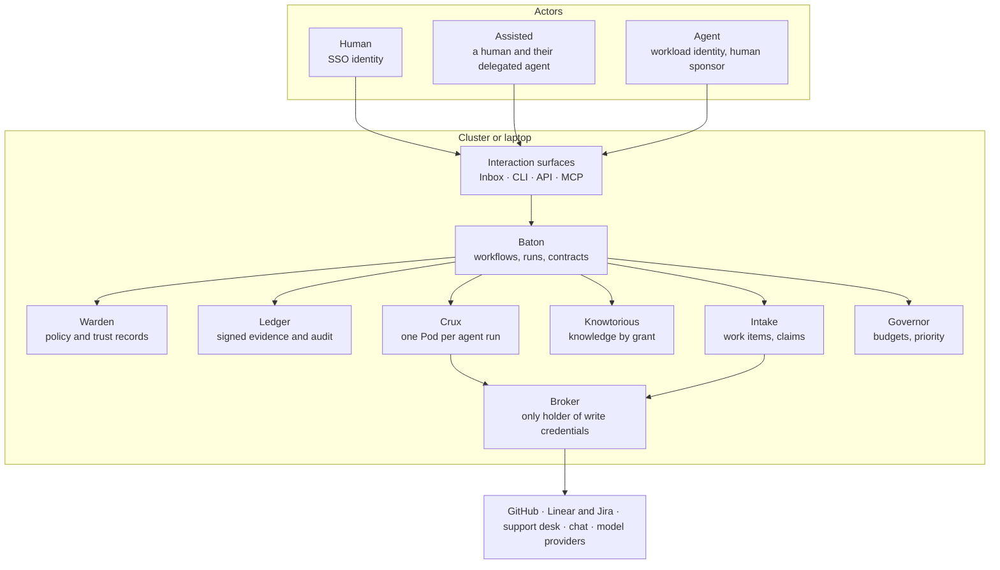

# RFC 0001: Junto, a trust-first, Kubernetes-native SDLC platform

- **Status:** Draft
- **Author:** Greg
- **Created:** 2026-10-29

## Summary

We split Hive into a set of small, Kubernetes-native services with Crux as the agent runtime, Baton as the workflow engine and a new Knowtorious service for knowledge. Every step in the pipeline is an **Interaction Contract** that any of three actors can fulfil: a Human, a Human with Agent assistance, or an Agent alone.

Hive already proves the hard parts. It has deterministic guardrails, signed evidence bundles, trust tiers and an autonomy dial (ACMM). But it ships as one daemon in one pod, its stage machine is hard-coded to GitHub labels, and it has no CRDs or operator. Knowledge has per-agent scopes but no per-human or group RBAC.

The proposal keeps Hive's trust ideas and moves them into the platform's API. Trust is decided per interaction point, not per installation. Workflows are config (Baton). State lives in plain files locally and Kubernetes resources on a cluster. Product, engineering and customer support then run as three workflow packs on one control plane.

Junto is the product and Junto Labs is the company, at juntolabs.dev and GitHub org `junto-labs`, named after Benjamin Franklin's club of makers who met to improve each other's work.

## Goals, non-goals and principles

The goal is one control plane that can run a full SDLC loop, from customer signal to shipped fix, with a verifiable record of who did what and under whose authority.

**Goals**

- Run product, engineering and customer support workflows on one platform.
- Let every step be done by a Human, an Assisted human or an Agent, chosen per step and changeable without redesign.
- Be Kubernetes-native: CRDs, controllers, RBAC, namespaces as tenants, GitOps-friendly.
- Make trust measurable: every transition produces evidence, and autonomy is earned from that evidence.

**Non-goals for v1**

- Replacing GitHub, Linear, Jira or a support desk. They stay systems of record; we orchestrate them.
- A general-purpose BPM engine. Baton stays small and opinionated.
- Multi-cluster federation. Hive's hub/spoke model comes later.

**Design principles**

1. **Interface first.** Define the contract for a step before deciding who does it.
2. **Deterministic guardrails.** Anything a human would decide the same way every time is enforced in code, not in a prompt (Hive's rule).
3. **No self-approval.** The approver is always a different principal from the author.
4. **Workflows are config.** The engine knows nothing about specs, tickets or PRs (Baton's rule).
5. **Fail closed, record everything.** A missing policy, credential or evidence item blocks the step and is logged.
6. **Unix philosophy.** Each component is one binary that does one job, works alone, and composes with the others only through files, JSON, exit codes and MCP.

## Actor model

Every action has exactly one accountable **principal** and an optional **delegate**; the persona is just which combination is present. This keeps "who is responsible" unambiguous even when an agent did the typing.

| Persona | Principal (accountable) | Delegate (acts) | Identity | Hive today |
| --- | --- | --- | --- | --- |
| Human | A person | none | OIDC user (SSO) | Dashboard user, `author/human` |
| Assisted | A person | That person's agent | User OIDC + signed delegation to the agent's workload identity | Contributor's "clanker", claim kind `contributor` |
| Agent | An agent, sponsored by a human or team owner | none | Workload identity (SPIFFE / k8s ServiceAccount + minted OIDC) | Hive agents, `author/hive` |

**Rules**

- An Assisted action counts as the human's action for four-eyes purposes. A person cannot approve work that their own agent drafted.
- Every Agent has a named human or team **sponsor**. The sponsor is who gets paged, and whose trust ceiling caps the agent.
- Delegation is explicit, scoped and short-lived: which interfaces, which resources, until when. Hive's Ed25519 delegation chains (`pkg/delegation`) and token minting (`pkg/mint`) are the starting point.
- The persona is recorded on every evidence entry, so we can later compare outcomes by persona for the same step.

## Interface first: the Interaction Contract

An **InteractionContract** defines a step's inputs, outputs, evidence and permitted personas, independent of who fulfils it. Baton nodes reference contracts; they never embed prompts or UI.

One contract is served on four surfaces from the same schema: a web inbox form for Humans, a CLI, an API, and an MCP tool for agents. A Human and an Agent therefore see the same task, the same inputs and the same definition of done. That is what makes switching a step from Human to Agent a policy change, not a rewrite.

```yaml
apiVersion: juntolabs.dev/v1alpha1
kind: InteractionContract
metadata:
  name: triage-support-ticket
spec:
  inputs:
    schemaRef: schemas/ticket.json
    knowledge: [support/runbooks, product/known-issues]   # Knowtorious spaces
  outputs:
    schemaRef: schemas/triage-result.json   # severity, category, linked_issue?, reply_draft
  evidence:
    required: [classification-rationale, knowledge-citations]
  actors:
    allowed: [Human, Assisted, Agent]
    default: Assisted
    minTrust: contributor        # per-contract, not per-installation
  review:
    fourEyes: when-outputs.severity in ['sev1','sev2']
  sideEffects:
    - kind: forge.comment        # executed by the broker, never by the actor
  sla: 4h
```

A separate **ActorBinding** decides who fulfils a contract in a given namespace. It names a persona, a pool (team, agent definition) and the trust conditions under which it may be promoted or demoted. This is Hive's ACMM level, made granular: one team can run triage at Agent level while release approval stays Human.

Outputs are never written straight to GitHub, Linear or a support desk. The actor returns a typed result; the platform's broker performs the side effect. That is how Hive's write relays already work.

## Trust model

Trust is built from four layers, and each layer is enforced by a component, not by a prompt.

| Layer | Question it answers | Mechanism | From Hive |
| --- | --- | --- | --- |
| Identity | Who is acting, for whom? | SSO for humans, workload identity for agents, signed delegation for Assisted | `pkg/auth`, `pkg/mint`, `pkg/delegation` |
| Authorization | May this actor do this step, on this resource, now? | Kubernetes RBAC for the API, a policy engine (CEL first) for contract-level rules | ACMM matrix, dashboard roles, `crux/agentmode` |
| Containment | What can go wrong if the actor misbehaves? | Pod per agent run, egress broker, input scanning, no direct write credentials | `crux/proxy`, `pkg/writeback`, `pkg/ioscan`, `crux/kubejob` |
| Evidence | Can we prove what happened? | Signed, hash-chained evidence bundle per transition | `pkg/evidence`, audit log |

**Earned autonomy.** Each (actor, contract) pair has a trust record computed from its evidence: approval rate, rework rate, reverts, escalations and gate overrides. Promotion (e.g. Assisted to Agent for triage) needs a human approval and is recorded. Demotion is automatic when the score drops below the binding's floor.

This fixes two gaps that Hive's own security model lists: trust tiers never decay, and trust is set per installation rather than per task. It also turns Hive's README metrics (65.5% of returned PRs later approved) into a per-step, per-persona signal that the platform acts on.

**Four-eyes is a platform rule.** Baton's decision nodes require an approver whose principal differs from the author's. For irreversible steps (merge to main, customer-visible reply, production deploy) the approver must be a Human or Assisted actor until a policy explicitly says otherwise.

## Decomposing Hive into components

Hive breaks cleanly into ten components. Crux already stands alone, Baton and Knowtorious are new, and the other seven are extracted from Hive's packages. Names other than Crux, Baton and Knowtorious are working names.



Baton drives every run; it asks Warden before each step and records the result in Ledger. Actors never hold write credentials: the Broker performs the side effects.

| Component | Responsibility | Extract from Hive | Status |
| --- | --- | --- | --- |
| **Baton** | Workflow definitions and run state; node types task, decision, gate, wait | `pkg/stageengine`, `pkg/beads`, `pkg/planning`, `pkg/celtrigger`, `pkg/hooks` | Fork and rebuild of Spektacular |
| **Crux** | Agent runtime: launch, kick, watchdog, sandbox | `src/crux` (already split out) | Exists; needs a controller |
| **Knowtorious** | Knowledge spaces, RBAC, lifecycle, connectors, MCP | `pkg/knowledge`, `pkg/codeindex`, `pkg/housestyle` | New |
| **Warden** | Policy decisions, trust records, autonomy bindings, intent checks | ACMM packs, `pkg/intent`, `pkg/decisionpolicy`, `pkg/holdguard`, `pkg/sentinel`, contributor tiers | Extract |
| **Broker** | The only component holding write credentials; performs side effects | `pkg/writeback`, write relays, `crux/proxy`, `crux/pushbroker`, `pkg/apiproxy` | Extract |
| **Ledger** | Signed evidence bundles and audit trail | `pkg/evidence`, `pkg/agentaudit`, `pkg/compliance`, dashboard audit | Extract |
| **Intake** | Pull work from forges and desks, dedupe, claim | `pkg/worksource`, `pkg/claims`, `pkg/issueclaim`, `pkg/classify`, `pkg/dupsweep` | Extract |
| **Governor** | Capacity, budgets, fair share, priority | `pkg/governor`, `pkg/tokens`, `pkg/scheduler` | Extract |
| **Inbox** | Human surface: tasks waiting on a person, approvals, overrides | `pkg/dashboard` | Rebuild on the new API |
| **Adapters** | GitHub, Linear, Jira, support desk, chat | `pkg/github`, `pkg/forge`, `pkg/linearagent`, `pkg/notify` | Extract; add support desk |

**Existing hivecommons tools, reused**

- [Spektacular](https://github.com/hivecommons/spektacular): forked and rebuilt as Baton. Its spec, plan and implement flows ship as Baton's first workflow pack.
- [pluk](https://github.com/hivecommons/pluk): session event stream, feeding the platform event bus.
- [promptargs](https://github.com/hivecommons/promptargs): renders contract prompts for each agent backend.
- [rationguard](https://github.com/hivecommons/rationguard): a gate type that rejects rationalising agent output.
- [dibs](https://github.com/hivecommons/dibs): contributor credit, fed from Ledger evidence.

## Repositories and the Unix philosophy

Each component lives in its own repo in the `junto-labs` org. Each one is a single binary that does one job and runs alone on a laptop, in CI, inside Claude Code or on Kubernetes. They connect only through files, JSON, exit codes, events and MCP, never through each other's code.

**The rules every repo follows**

1. **One job, one binary.** `baton` tracks workflow state, `knowtorious` serves scoped knowledge, `ledger` records evidence. None of them does another's job.
2. **No imports between components.** The shared vocabulary lives in `junto-spec`, a repo that holds only JSON Schemas (Actor, InteractionContract, Evidence, WorkItem, event types). Each component validates against it and nothing else.
3. **Text in, JSON out.** Every command reads files or stdin and writes human text by default, `--json` on request. Exit code 0 means pass, 1 means fail, 2 means usage error. Any tool can then act as a Baton gate.
4. **Plain files first.** Default state is a folder in the repo (`.baton/`, `.knowtorious/`) that you can diff and review. Postgres, object storage or CRDs are opt-in backends behind the same interface.
5. **Absent neighbours are fine.** With no Warden, Baton reads a local policy file. With no Ledger, evidence goes to a JSONL file. With no Broker, side effects are printed as a plan for a human to run.
6. **Four faces, one core.** Each binary has a CLI, an `mcp` subcommand that serves the same operations to agents, a Claude Code plugin, and optionally a `controller` subcommand with a Helm chart.

**Repos**

| Repo | Origin | Its one job | Runs standalone as | Claude Code |
| --- | --- | --- | --- | --- |
| `baton` | Import of [Spektacular](https://github.com/hivecommons/spektacular), rebuilt | Workflow definitions and run state | `baton next`, `baton pass` over `.baton/` | Plugin: skill, `/baton` commands, MCP |
| `knowtorious` | New | Scoped, access-controlled knowledge | `knowtorious search` over a markdown vault | Plugin: MCP tools, session-start primer |
| `crux` | Fork of [hivecommons/crux](https://github.com/hivecommons/crux) | Run and supervise agent sessions | `crux run`, `crux serve` (already) | Not needed; it runs Claude Code |
| `warden` | Extracted from Hive (later) | Policy decisions and trust records | `warden check` with an exit code | Optional hook that blocks disallowed tools |
| `ledger` | Extracted from Hive (later) | Append and verify signed evidence | `ledger append`, `ledger verify` on JSONL | Optional hook that records each step |
| `broker` | Extracted from Hive (later) | Perform side effects with held credentials | `broker do request.json` | Not exposed to agents |
| `intake` | Extracted from Hive (later) | Pull work from forges and desks | `intake pull linear` to JSONL | Optional MCP |
| `junto-spec` | New | Shared schemas only | n/a | n/a |
| `junto` | New | Assembly and project docs: Helm umbrella chart, Claude Code plugin marketplace, example stacks, RFCs | n/a | Marketplace of all plugins |

Hive itself is forked (archived) as a read-only reference to extract from, along with the small tools we reuse (pluk, promptargs, rationguard). Governor and Inbox come later. All upstreams are Apache-2.0, so the forks keep LICENSE and NOTICE and credit Hive Commons.

**The domain is the public address; GitHub is only where code lives.**

| What | Address |
| --- | --- |
| Go modules (vanity import path) | `juntolabs.dev/baton`, `juntolabs.dev/knowtorious`, `juntolabs.dev/crux` |
| Kubernetes API group | `juntolabs.dev` (e.g. `juntolabs.dev/v1alpha1`) |
| Docs, Helm charts, Claude Code plugin marketplace | served from `juntolabs.dev` |

A vanity path needs a small redirect page per module on the domain, pointing at `github.com/junto-labs/<repo>`. Crux keeps its upstream module path (`github.com/hivecommons/crux`) while we still merge from upstream.

**Subsets that work on their own**

| Who | Components | State lives in |
| --- | --- | --- |
| Solo developer in Claude Code | `baton` + `knowtorious` plugins | Files in the repo |
| Team running agents on a VM | + `crux`, `ledger`, `broker` | Files plus a JSONL evidence log |
| Governed team | + `warden`, `intake` | Shared Postgres, SSO |
| Full platform | All, in controller mode | Kubernetes CRDs plus stores |

**Pipes, not plumbing**

```bash
# A Baton gate is just a command and its exit code
baton gate add spec-ready --cmd 'knowtorious lint --space product --state draft --max 0'

# Evidence flows from one tool into another
knowtorious search 'refund policy' --space support/runbooks --json \
  | baton pass --run r-42 --evidence -

# Every pass can be recorded without Baton knowing Ledger exists
baton log --run r-42 --json | ledger append --stream runs/r-42
```

**Inside Claude Code.** Installing the `baton` plugin adds a skill that teaches the loop (`baton next`, do the step, `baton pass`), slash commands such as `/baton start` and `/baton status`, and an MCP server so the agent calls Baton directly. The human in the session is the Assisted actor; Baton's four-eyes rule still applies, so an agent's `pass` on a decision node waits for the human's approval. The `knowtorious` plugin adds an MCP server with `search`, `get` and `propose` tools and a session-start hook that loads a short primer. Its local vault uses Spektacular's knowledge folders (architecture, conventions, decisions, glossary, gotchas, learnings), so existing `.spektacular/knowledge` content imports unchanged.

## Kubernetes API: CRDs and controllers

Kubernetes is one place to run the components, not a requirement. On a cluster, the platform is a set of CRDs in one API group, each owned by the `controller` mode of one binary, with a namespace per team or product as the tenancy boundary. Hive has no CRDs today: `AgentDefinition` is a file format only, and the hub provisions namespaces with direct API calls. We keep `AgentDefinition`'s shape so existing definitions import unchanged.

| Kind | Owner | Purpose |
| --- | --- | --- |
| `Actor` | Warden | A person, team or agent; persona, sponsor, trust record reference |
| `Delegation` | Warden | Time-boxed grant from a human to their agent, scoped to contracts |
| `ActorBinding` | Warden | Who fulfils a contract in this namespace, with promote and demote rules |
| `TrustPolicy` | Warden | CEL rules and floors per contract; ACMM levels become presets |
| `InteractionContract` | Baton | Inputs, outputs, evidence, allowed personas for one step |
| `Workflow` | Baton | A graph of nodes referencing contracts; installable as packs |
| `WorkflowRun` | Baton | One execution; status holds current node and tracked items |
| `WorkItem` | Intake | A unit of work mirrored from GitHub, Linear, Jira or a support desk |
| `AgentDefinition` | Crux | Backend, model, tools; same YAML as today |
| `AgentRun` | Crux | One agent session for one task, run as a Pod or Job |
| `KnowledgeSpace`, `KnowledgeSource`, `KnowledgeGrant` | Knowtorious | Spaces, connectors and who can read or write them |

**Where data lives.** CRDs hold desired state and small status. Etcd is not a database, so evidence goes to an append-only store (Postgres plus object storage), knowledge to Knowtorious's own store, and transcripts to object storage. A CRD status links to them by digest.

**Controllers.** Each component's controller mode is a controller-runtime operator shipped as its own Helm chart and image, so a team can adopt Crux or Knowtorious alone. One umbrella chart installs the whole platform. Events travel as CloudEvents on NATS so components stay decoupled.

**Per-agent isolation.** Hive runs every agent as a tmux session in one pod. Here each `AgentRun` is its own Pod with its own ServiceAccount, NetworkPolicy allowing egress only to the Broker and model gateway, and no forge credentials. Crux's `kubejob` sandbox is the seed of this.

**Crux terminal backends.** Crux has a partial `TerminalSession` interface (`agent/terminal.go`) for reading panes and sending keys, but 58 non-test files reference tmux and 24 call sites run tmux lifecycle commands directly. Widening that interface to cover session lifecycle (create, kill, set environment, stream logs) lets tmux stay the default while an optional backend such as [Rex](https://www.superlogical.com/rex/docs/installation) is added. Crux should also parse the Program Status Protocol (`OSC 7501`) from the output stream on any backend, replacing screen-scraped agent state with structured `working` / `blocked` / `done` / `error` reports.

## Baton on Kubernetes

Baton is Spektacular imported and rebuilt as a generic engine: one library with three hosts. They are the single-binary CLI from [RFC #95](https://github.com/hivecommons/spektacular/issues/95), an MCP server for Claude Code and other agents, and a controller that stores run state in `WorkflowRun` resources. The same workflow YAML runs in all of them, so a team can prototype a flow on a laptop and promote it to the cluster unchanged.

- **State store interface.** File store (`.baton/runs/<id>.json`) for the CLI; CRD store for the controller. The engine itself is pure: given a run and an event, it returns the next state.
- **`next` and `pass` become API calls.** An actor asks for its next node; the controller resolves the node's contract and `ActorBinding` to decide whether to create an `AgentRun`, put a card in a human's Inbox, or both (Assisted).
- **Gates are evaluated by the engine**, never by the actor that did the work. CEL expressions over outputs, tracked items and evidence, checked at load time, as [PR #105](https://github.com/hivecommons/spektacular/pull/105) proposes.

```yaml
apiVersion: juntolabs.dev/v1alpha1
kind: Workflow
metadata:
  name: support-to-fix
spec:
  start: triage
  nodes:
    triage:   { type: task,     contract: triage-support-ticket, next: route }
    route:    { type: decision, contract: route-ticket,
                routes: { answer: reply, bug: file-bug, feature: product-intake } }
    reply:    { type: task,     contract: draft-customer-reply, next: reply-ok }
    reply-ok: { type: gate,     contract: approve-customer-reply,
                pass: done, fail: reply }        # loop only on gate failure
    file-bug: { type: task,     contract: file-linked-bug, next: wait-fix }
    wait-fix: { type: wait,     until: "workItem(outputs.bug).state == 'released'", next: reply }
```

**Closing the six gaps PR #105 found**

| Gap | Proposed answer |
| --- | --- |
| Engine side effects (scaffolds, auto-commit) | Declared as `sideEffects` on the contract; performed by the Broker (or printed as a plan) after the node passes |
| Backward routes chosen by a human | Allowed on decision nodes if every cycle contains a gate (PR #105's rule) |
| Human override of a failed gate | An `override` action that needs four-eyes and writes an evidence entry |
| Item statuses beyond open and resolved | Add `deferred` and `abandoned`; abandoned items need a reason and do not trigger stall detection |
| Mutually exclusive workflows | Several runs per work item, with an exclusivity key enforced by the engine |
| Engine-computed template variables | Computed into the contract's input context, rendered by promptargs |

## Knowtorious: RBAC knowledge management

Knowtorious takes Hive's knowledge store (fact types, layers, lifecycle, confidence, connectors) and adds what it lacks: per-person and per-group access control, classification, and an audited read path for every actor.

**Model**

- **Space**: a tree that mirrors the org (org, product, team, repo, personal). Replaces Hive's four fixed layers.
- **Entry**: a fact, document chunk or decision, with type, lifecycle state (draft, approved, deprecated, superseded), confidence and source.
- **Classification**: `public`, `internal`, `confidential`, `customer-restricted`. An actor needs clearance at or above the label.
- **Grant**: subject (Actor, Group, or persona) + role on a Space. Roles are `reader`, `contributor` (may propose drafts), `curator` (may approve), `owner`.

**How agents get access**

| Persona | Effective access |
| --- | --- |
| Human | Their grants |
| Assisted | The intersection of the human's grants and the delegation's scope; never more than the human |
| Agent | The intersection of its own grants, its sponsor's ceiling, and the knowledge the current contract declares |

The last row is the key trust property. An agent working a support ticket sees `support/runbooks` and `product/known-issues` because the contract asked for them, not because the agent can read everything.

**Enforcement**

- Checks run at retrieval time, before ranking, so an out-of-scope entry never reaches a prompt. A relationship-based store (OpenFGA or SpiceDB) answers `can Actor read Space` on a cluster; a local policy file does it on a laptop.
- Connectors carry source permissions across. A Google Drive or Confluence page keeps its sharing rules rather than becoming readable to everyone in the Space.
- Untrusted text is scanned with Hive's `ioscan` on ingest, and `customer-restricted` content is redacted for actors without clearance.
- Every read and write is an evidence event. Every answer an agent uses carries citations, which the contract's evidence can require.
- Agents can only propose drafts. A curator, a different principal, approves them. Hive's bead synthesizer and curator become draft producers.

**Interfaces**: CLI, REST, an MCP server for agents (an authorised version of Hive's public knowledge MCP), and the `KnowledgeSpace`, `KnowledgeSource` and `KnowledgeGrant` CRDs for GitOps.

## The SDLC pipeline: product, engineering, support

The three functions are three Baton workflow packs joined by `WorkItem` links, so a support ticket can become a product request, then a spec, then a release, and the customer hears back when it ships.

The starting personas below are conservative: agents draft, humans approve anything irreversible or customer-visible. Each row's persona is an `ActorBinding`, so teams move steps right as trust records justify it.

| Pack | Step (contract) | Starting persona | Approver | Can later become |
| --- | --- | --- | --- | --- |
| Support | Triage ticket | Agent | none (spot-checked) | Agent |
| Support | Draft customer reply | Assisted | Human | Agent for known issues |
| Support | Escalate to bug or request | Agent | Human (product or eng owner) | Agent |
| Product | Cluster signals into opportunities | Agent | none | Agent |
| Product | Prioritise roadmap | Human | Human (second) | Assisted |
| Product | Write spec | Assisted | Human | Assisted |
| Engineering | Plan from spec | Agent | Human | Agent with Agent review |
| Engineering | Implement plan | Agent | Agent reviewer, then Human | Agent |
| Engineering | Merge | Human | n/a | Agent on green gates (Hive's L6) |
| Engineering | Release to production | Human | Human (second) | Assisted |
| Support | Notify customer of fix | Assisted | Human | Agent |

## Roadmap

Build trust plumbing first, then the engine, then knowledge, then the full product-to-support loop; each phase ends at a gate we can demo, not a date.

| Phase | Scope | Gate |
| --- | --- | --- |
| 0 · Foundations | `junto-spec` schemas; Actor, Delegation and ActorBinding; extract Ledger and Broker from Hive; Crux lifecycle interface | One agent action traced end to end, with a signed evidence bundle |
| 1 · Workflow engine | Baton library, CLI, MCP and Claude Code plugin; InteractionContract; Spektacular's flows as the engineering pack | Spec to merged PR with four-eyes enforced by the platform |
| 2 · Knowledge and trust | Knowtorious MVP (vault, search, MCP, plugin, Spektacular import), then spaces and grants; Warden trust records with automatic demotion | An agent reads only what its contract declares; bad evidence triggers a demotion |
| 3 · Full loop | Support and product packs, a support desk adapter, WorkItem links; Intake and Governor extracted | A ticket becomes a fix and the customer is told, on one evidence chain |
| 4 · Earned autonomy | Human-approved promotions, agent-plus-agent review, parallel nodes, shareable packs; controllers and multi-cluster | Autonomy changes driven by evidence, not configuration |

**First milestone (laptop, no Kubernetes):** in a Claude Code session, start a Baton workflow, have the agent pull context from Knowtorious, and confirm Baton will not pass the approval node until a different principal (the human) signs off.

## Open questions and decisions

- [x] **Baton's home.** Decided: import Spektacular into `junto-labs/baton` and rebuild it. Open: whether to offer the generic engine back to hivecommons later.
- [x] **Where the platform lives.** Decided: independent org `junto-labs`, domain `juntolabs.dev`. Open: how to tell Junto apart from the existing open-source Junto social app.
- [ ] **Does agent review count as four-eyes?** Proposal: only when the reviewer has a different sponsor and model family, and never for irreversible steps.
- [ ] **Policy language.** CEL everywhere (matches Hive's triggers and PR #105), or CEL for gates plus OPA or Kyverno for admission.
- [ ] **Evidence store.** Postgres with hash chaining, or a transparency log such as Sigstore Rekor for external verifiability.
- [ ] **Trust score.** Which signals count, their weights, decay rate, and who approves promotions.
- [ ] **First support desk.** Which one to build the adapter for first.
- [ ] **Knowtorious authorisation backend.** OpenFGA or SpiceDB.
- [ ] **Rex as a Crux backend.** Pending Superlogical's answers on license, Linux server redistribution, and a send-input API.

## Sources

- [RFC #95: baton workflow engine](https://github.com/hivecommons/spektacular/issues/95)
- [PR #105: baton RFC coverage of Spektacular workflows](https://github.com/hivecommons/spektacular/pull/105)
- [hivecommons/hive](https://github.com/hivecommons/hive): README and `src/docs` (security-model, acmm-policy-matrix, contributor-trust-and-roles, knowledge-*, kubernetes-deployment, github-write-surface, evidence)
- [hivecommons/crux](https://github.com/hivecommons/crux): README and `defs`, `kubejob`, `proxy`, `agent/terminal.go`
- [hivecommons/spektacular](https://github.com/hivecommons/spektacular): README
- [Rex docs](https://www.superlogical.com/rex/docs/installation) and [Program Status Protocol](https://www.superlogical.com/rex/docs/build/program-status)
